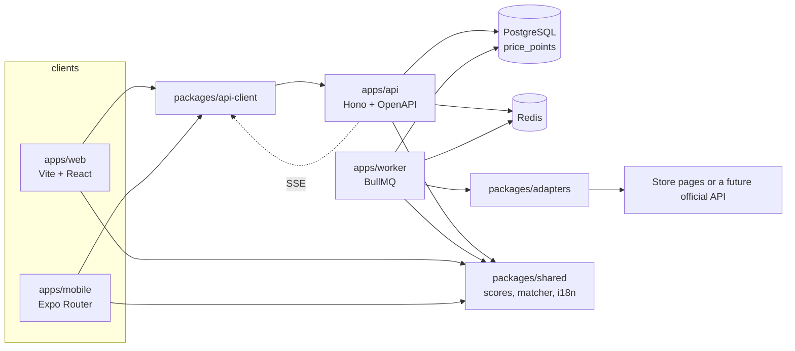
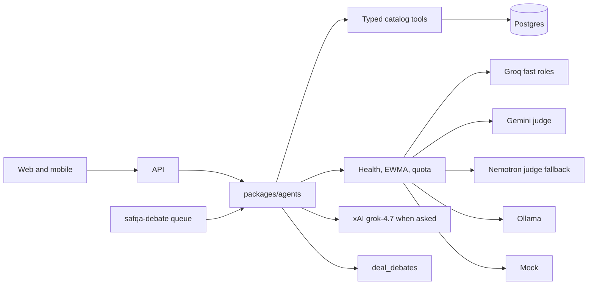

# صفقة · Safqa

Price tracking for Egyptian stores. One TypeScript monorepo, three running parts: an API and crawl worker, an Arabic-first website, and an Expo app. They share Zod schemas and one API client, so a watchlist edit on the web shows up on mobile for the same account.

## English

### Architecture



| Piece | Role |
| --- | --- |
| `packages/shared` | Deal score, fake-discount detector, Arabic/English matcher, Zod contracts, copy |
| `packages/adapters` | One adapter interface, JSON-LD parser, 10 store adapters, robots.txt, per-host gaps |
| `packages/db` | Drizzle schema, SQL migrate, seed, queries. `price_points` is hypertable-ready |
| `packages/notify` | Web Push, Expo push, Telegram. Each channel reports `not_configured` until its env is set |
| `packages/api-client` | Typed client plus an SSE subscriber used by web and mobile |
| `apps/api` | REST, OpenAPI at `/docs`, auth, watchlist, alerts, `GET /api/events` |
| `apps/worker` | Minute tick. Hot products hourly, warm every 6 hours, cold every 48 hours |
| `apps/web` | Arabic RTL by default, English toggle, dark mode, PWA shell |
| `apps/mobile` | Same deals, search, product chart, watchlist, Expo push registration |

### Agents

Five roles share one transcript and a tool loop. The historian, market analyst, trust analyst, and skeptic each call typed tools (`get_price_history`, `get_seasonality`, `get_ratings`) before they speak. The judge does not call tools. It reads what the others said and returns a score, `buy_now` / `wait` / `skip`, and an Arabic explanation. The skeptic is required to call the history tool itself, so it can disagree with the historian.

The debate router spreads calls across every configured free model. Fast roles (historian, market, trust, skeptic, assistant) prefer Groq. The judge prefers Gemini, then a Nemotron `:free` model. Gemini stays on the AI Studio free tier. Checked on 10 Nov 2026 against [Gemini pricing](https://aistudio.google.com/docs/pricing): `gemini-3.8-flash` input and output are free of charge. The OpenAI-compatible base URL is `https://generativelanguage.googleapis.com/v1beta/openai/`.

`gemini-3.8-flash` often answers HTTP 503 when demand is high. On 503 or 429 Safqa opens that model's circuit for 60 seconds and picks another live model. Inside Gemini the order is `gemini-3.8-flash`, `gemini-3.7-flash`, `gemini-3-flash-preview`, `gemini-2.5-flash` (`GEMINI_MODELS` replaces it). `gemini-3-flash-preview` is the one confirmed working when 3.8 is overloaded.

The router is a load balancer, not only a fallback list. It spreads the debate across configured models at once: historian, market, and trust run in parallel, each on a different healthy endpoint. Fast roles prefer Groq (`openai/gpt-oss-120b`, `qwen/qwen3.8-27b`, `openai/gpt-oss-20b`). Qwen is that Groq model, not a separate provider. The judge prefers Gemini, then Nemotron: NVIDIA NIM `nvidia/nemotron-3-ultra-550b-a55b` when `NVIDIA_API_KEY` is set, and the OpenRouter `:free` ids `nvidia/nemotron-3-ultra-550b-a55b:free` and `nvidia/nemotron-3.5-super-vl:free`. `openrouter/free` stays in the pool but is deprioritized because it often lands on gemma-4 and returns 429. OpenRouter's free tier on this account is 50 requests/day. Groq's free plan is about 1,000 requests/day per model. Each call aborts after `LLM_TIMEOUT_MS` (30s). Fast roles also send a hedged request to a second provider if the first is still running after `LLM_HEDGE_MS` (8s). A timeout, 429, or 503 opens that model's circuit for 60 seconds. `/admin` shows the circuit, latency, and quota for each model.

NVIDIA NIM is `https://integrate.api.nvidia.com/v1`. Developer Program trial access is for prototyping, not production (API Trial Terms, 19 Sep 2025). The verified model on this key is `nvidia/nemotron-3-ultra-550b-a55b`. Two other NIM ids are listed by the catalog and are not routed: `deepseek-ai/deepseek-v4.1-flash` (timed out past 100s) and `moonshotai/kimi-k2.6` (HTTP 404 on this account). Mistral is not in the pool; it needs a paid plan. DeepSeek's own API stays an optional paid slot via `DEEPSEEK_API_KEY`.

Get a key:

1. Open [Google AI Studio API keys](https://aistudio.google.com/apikey) and sign in.
2. Create an API key in a Google Cloud project. Leave billing off if you want the free tier.
3. Put the key in `GEMINI_API_KEY` (`GOOGLE_API_KEY` is accepted only when `GEMINI_API_KEY` is empty).
4. Open [your project's rate limits](https://aistudio.google.com/rate-limit). Google does not publish one fixed free quota, and the rate-limit page says the numbers are not guaranteed. A free project read on 21 Oct 2026 showed **5 requests/minute, 250,000 input tokens/minute, and 20 requests/day** for Gemini 3.8 Flash. Set `GEMINI_RPM` and `GEMINI_RPD` to what your project shows. Safqa queues calls to stay inside the per-minute cap, retries HTTP 429 with `Retry-After` or exponential backoff, and moves to the next provider when the daily cap is already used.

A debate is several calls, so 20 requests/day is about two debates. `gemini-3.5-flash-lite` is also free of charge on that pricing page and, on the same AI Studio reading, had a larger daily cap. Set `GEMINI_MODEL` if you want it.

| Role | Preferred models | Daily cap |
| --- | --- | --- |
| Fast roles | Groq `openai/gpt-oss-120b`, `qwen/qwen3.8-27b`, `openai/gpt-oss-20b` | `GROQ_RPD` per model, default 1,000 |
| Judge | Gemini chain, then NVIDIA NIM `nvidia/nemotron-3-ultra-550b-a55b`, then OpenRouter Nemotron `:free` | `GEMINI_RPD` shared, default 20; `OPENROUTER_RPD` shared, default 50 |
| Last | Ollama, then mock | none |

`LLM_ROLE_SKEPTIC=xai:grok-4.7` pins that role while the model is healthy. Grok has no free tier; `grok-4.7` needs `XAI_API_KEY` and prepaid credit. The same pin works for `openai`, `anthropic`, `groq`, `nvidia`, `deepseek`, `together`, and `cohere`. A 429, 503, or 30s timeout opens that model's circuit for 60 seconds and the next call uses another endpoint. `LLM_PROVIDER=mock` never calls the network.

Other free or trial access, same date: Groq's free plan (about 30 requests/minute and 1,000 requests a day per model), NVIDIA NIM trial endpoints for Developer Program members (prototyping only), Cohere trial keys (about 1,000 calls/month, not for production). OpenAI chat and the official DeepSeek API have no standing free tier. Together starts with a credit purchase. Anthropic gives new accounts a small unpublished credit, then charges. Mistral needs a paid plan and is not called. The admin page lists which keys are set, the model each role will call, and this free-tier note. It never shows the key itself.

Debates are stored and shown on the product page as نقاش الوكلاء. A fresh transcript is reused for six hours while the price fingerprint is unchanged. The worker queue `safqa-debate` runs the same function after a crawl that actually changed the page hash.

Example, inflated washer list price: the historian cites median ≈ current, the skeptic says `STANCE=challenge`, and the judge returns `skip`.

The shopping assistant is the same provider and `search_products`. Ask in Egyptian Arabic; the reply includes product cards.



Speed: `GET /api/deals` is cached in Redis for 30 seconds and sent with `Cache-Control`. A local run of 40 requests measured about 1.4 ms p50 and 8.4 ms p95. A cached debate read was about 7 ms. Crawl jobs carry BullMQ priority (hot, then warm, then cold). Unchanged HTML (sha256) does not write a new price point. `WORKER_CONCURRENCY` is per process; more worker containers share the queue. Search is limited to 24 cards and deal cards use `content-visibility`.

Also in this pass: a buy-now versus wait forecast, bank-code and coupon stacking, a retail calendar (11.11, White Friday, Ramadan), a watchlist digest, a Telegram webhook, an unpacked browser extension in `apps/extension`, affiliate tag rewriting, an admin page, and JSON logs plus an optional OTLP span export.

The crawler sends `SafqaBot/0.1`, reads `robots.txt`, and waits between requests to a host (5s, 8s for amazon.eg). A captcha or HTTP 403/429 stops that URL. There is no browser impersonation and no captcha solver. Amazon.eg is a best-effort JSON-LD adapter with a Creators API seam in `packages/adapters/src/providers/amazon-creators.ts`.

### Run it locally

Requirements: Node 22, pnpm 10, Docker.

```bash
cp .env.example .env
pnpm install
docker compose up --build
```

That starts TimescaleDB (Postgres 16), Redis, the API on port 8787, and the worker. The API migrates and seeds on boot (`SEED_ON_BOOT=true` in Compose).

In other terminals:

```bash
pnpm dev:web      # http://localhost:47321
pnpm dev:mobile   # Expo, port 47323
```

`pnpm dev` runs the API, worker, and website together when Postgres and Redis are already up (for example from Compose, or from a local install).

Demo account: `demo@safqa.app` / `demo1234`.

OpenAPI: http://localhost:8787/docs

Without Docker, point `DATABASE_URL` and `REDIS_URL` at your own Postgres 16 and Redis, then:

```bash
pnpm db:migrate
pnpm db:seed
pnpm dev:api
pnpm dev:worker
pnpm dev:web
```

If TimescaleDB is not installed, migration keeps `price_points` as a normal table. The primary key is `(offer_id, captured_at)`, which is what `create_hypertable` needs. Turn the extension on later and re-run migrate.

### Checks

```bash
pnpm lint
pnpm typecheck
pnpm test
pnpm sync:check   # web client writes a watch, mobile client reads it, SSE fires
```

### Add a store adapter

1. Add a draft in `packages/adapters/src/registry.ts` with `createHtmlAdapter`.
2. Set `status` to `stub` until you have a fixture that proves the parse, then `best-effort`, then `structured` only when the source is an official feed.
3. Put an HTML fixture in `packages/adapters/src/fixtures` and assert `adapter.parse` in `jsonld.test.ts`.
4. If the site publishes schema.org `Product`, you are done: the shared JSON-LD parser fills `Offer`.
5. If it does not, do not invent a bypass. Prefer the merchant's affiliate or catalog API behind the `CatalogAwait` hook (see Amazon). A blocked response must stay a `BlockedBySite` error.
6. Re-seed (the store row is copied from the registry) or insert the store. Set `minIntervalMs` from the site's crawl-delay, never below a few seconds.

`NormalizedOffer` is `{ store, url, title, brand?, model?, ean?, priceEGP, listPriceEGP?, inStock, image?, rating? }`.

After a fetch, JSON-LD (`parseJsonLdOffer`) is the only price/title extractor. MarkItDown is a sidecar CLI (`MARKITDOWN_BIN`, default `markitdown`) that turns the page into compact markdown for the debate: the worker always requests it, stores it on the offer, and `runDebate` receives `formatProductLlmContexts()` as `pageContext`. A price that appears only in the markdown never overrides JSON-LD. The production image installs MarkItDown 0.1.7 in `/opt/markitdown`. If the CLI is missing, the crawl continues without page text.

### Roadmap, 10 stores to 100+

1. **Now.** Ten adapters. JSON-LD is the default. Stubs are labeled. Seed data runs the product without live crawling.
2. **Official feeds.** Amazon Creators API, then Noon and Jumia affiliate catalogs. HTML stays a fallback only when the partner API is not configured.
3. **Fixture contracts.** Each promoted adapter gets a checked-in HTML fixture and a test. A parser change that drops a price fails CI.
4. **Sitemaps, not crawls of search pages.** Discover URLs from `robots.txt` sitemaps the site allows. Users can also paste a product URL.
5. **Adapter manifests.** Most of the next 90 stores should be data: domain, interval, currency, status. Custom code only when JSON-LD is absent and a public API exists.
6. **Matching jobs.** Nightly EAN and fuzzy title passes (Arabic and English) merge new listings onto canonical products. Dubizzle stays `used` and never wins “best new price”.
7. **Operations.** Per-domain error rates, a kill switch per adapter, and Postgres backups. Do not raise rate limits to get past a block.

### Deploy

- **Free Render demo:** `render.yaml` at the repo root provisions a free web API (Docker), a free static site, free Postgres, and free Key Value. After pushing to GitHub, open `https://dashboard.render.com/blueprint/new?repo=https://github.com/FY881/safqa`, connect GitHub if asked, and click Apply. The public site URL is the `safqa-web` service; demo login is `demo@safqa.app` / `demo1234`. Free Postgres expires after 30 days, free web services spin down after 15 minutes idle, and the background worker is not included (workers are not free). `LLM_PROVIDER=mock` so no model keys are required.
- **Web (other hosts):** Vercel (or any static host). Build command `pnpm --filter @safqa/web build`, output `apps/web/dist`. Set `VITE_API_URL` to the public API origin. The service worker registers in production builds.
- **API and worker:** a small VPS (Hetzner or similar). Copy the repo, set a real `AUTH_SECRET`, and run `docker compose up -d`. Put Caddy or nginx in front of port 8787 for TLS. Do not publish Postgres or Redis.
- **Backups:** `pg_dump` the volume nightly. `price_points` grows with every observation; a hypertable plus a retention policy is the next step once Timescale is on.
- **Push:** generate VAPID keys for Web Push. Telegram and Expo stay off until `TELEGRAM_BOT_TOKEN` / a device token exist. Google login needs the three `GOOGLE_*` variables. Apple is a route that returns `oauth_not_configured` until the p8 client secret is implemented.

### What is real, and what is still a stub

Real in this foundation: schema and seed, deal score, fake-discount flags, bilingual matcher, JSON-LD parser, robots and rate limits, email auth with refresh tokens, Google OAuth when configured, watchlist, alert rules, SSE, Expo and Telegram and Web Push senders, website, and Expo screens.

Stub or best-effort, on purpose: live HTML for stores that block bots (amazon.eg, and several others), six adapters marked `stub` because they have no verified selectors, Amazon request signing, and Sign in with Apple's client-secret JWT. The worker will not evade a block. Sample prices are seeded so the UI does not depend on a live crawl.

---

## العربية

### المعمارية

المخطط فوق يوضّح نفس المسار: الويب والموبايل بيستخدموا عميل واحد (`packages/api-client`)، والـ API بيحفظ في Postgres وبيبعت التغييرات على Redis كـ Server-Sent Events. العامل (`apps/worker`) بيجدول الزيارات وبيحترم `robots.txt`.

الدرجة من ١٠٠ بتقارن السعر الحالي بوسيط ٣٠ يوم وأقل سعر في ٩٠ يوم. لو السعر المشطوب بعيد عن تاريخ البيع، العرض يتعلّم «خصم مضخّم» وينقص ٣٠ نقطة.

النقاش بين خمس وكلاء: مؤرخ السعر، محلل السوق، محلل الثقة، المعارض، والحكم. كل واحد بيطلب أدوات typed قبل ما يتكلم، والحكم بيقرأ الكلام ده وبيطلع توصية بالعربي. المؤرخ ومحلل السوق ومحلل الثقة بيشتغلوا في نفس الوقت، كل واحد على موديل سليم مختلف. الأدوار السريعة بتفضّل Groq (`openai/gpt-oss-120b` و `qwen/qwen3.8-27b` و `openai/gpt-oss-20b`)، وQwen من Groq مش مزود لوحده. الحكم بيفضّل Gemini، وبعده NVIDIA NIM `nvidia/nemotron-3-ultra-550b-a55b` لو `NVIDIA_API_KEY` موجود، ثم Nemotron المجاني على OpenRouter. لو الطلب عدّى ٣٠ ثانية، أو رجع 503 أو 429، صفقة بتقفل دائرة الموديل ٦٠ ثانية. الأدوار السريعة بتبعت طلب تاني لمزود ثاني لو الأول لسه شغال بعد ٨ ثواني. Mistral مش في التجمع لأنه محتاج خطة مدفوعة. DeepSeek الرسمي اختياري ومدفوع عبر `DEEPSEEK_API_KEY`. سلسلة Gemini: `gemini-3.8-flash` ثم `gemini-3.7-flash` ثم `gemini-3-flash-preview` ثم `gemini-2.5-flash`، وتتظبط بـ `GEMINI_MODELS`. المفتاح من [aistudio.google.com/apikey](https://aistudio.google.com/apikey) ويتحط في `GEMINI_API_KEY` من غير ما تفعّل الفوترة. الحدود الحية للمشروع في [aistudio.google.com/rate-limit](https://aistudio.google.com/rate-limit). صفقة بتستنى عشان متتجاوزش الطلبات في الدقيقة، وبتعيد المحاولة لو رجع 429، ولو الحصة اليومية خلصت بتكمل للي بعد كده. `openrouter/free` موجود بس متأخر لأن gemma-4 بيرجع 429 كتير. الحصة المجانية لـ OpenRouter على الحساب ده ٥٠ طلب في اليوم. لو مفيش مفتاح، Ollama ثم النموذج المحلي. Grok (`grok-4.7`) جاهز لو حطيت `LLM_ROLE_SKEPTIC=xai:grok-4.7` مع `XAI_API_KEY`، ومفيش طبقة مجانية لـ xAI. صفحة الإدارة بتعرض حالة كل مفتاح ودائرة كل موديل من غير ما تكتب السر. النقاش بيتخزن ويظهر في صفحة المنتج تحت «نقاش الوكلاء». المساعد في `/assistant` بيرد بالعامية وبعد ما يبحث في الكتالوج.

`XAI_API_KEY` اختياري للتشغيل المحلي. `ADMIN_TOKEN` مطلوب لصفحة الإدارة. تليجرام و Web Push و Expo و Google و أمازون كرييتورز كلهم اختياريين. الزحف لسه بيحترم robots.txt ومفيش حل للكابتشا.

### التشغيل المحلي

```bash
cp .env.example .env
pnpm install
docker compose up --build
pnpm dev:web
pnpm dev:mobile
```

الموقع: http://localhost:47321  
الواجهة البرمجية: http://localhost:8787/docs  
الحساب التجريبي: `demo@safqa.app` / `demo1234`

من غير Docker: ظبّط `DATABASE_URL` و `REDIS_URL` ثم `pnpm db:migrate && pnpm db:seed` وبعدين `pnpm dev:api` و `pnpm dev:worker` و `pnpm dev:web`.

### إضافة متجر

في `packages/adapters/src/registry.ts` ضيف محوّل بـ `createHtmlAdapter`. خلّي الحالة `stub` لحد ما يبقى عندك ملف HTML مثبت في الاختبارات. لو الموقع بينشر schema.org Product، المحلل العام بيكفي. لو الموقع بيرفض البوت، متكتبش التفاف. اربط واجهة الشراكة الرسمية في `CatalogAwait` زي أمازون.

بعد الجلب، التحليل الأساسي للسعر والعنوان هو JSON-LD (`parseJsonLdOffer`). العامل بيطلب MarkItDown بعد كل جلب، بيخزّن النص على العرض، والنقاش بياخد السياق ده عن طريق `pageContext`. `htmlToLlmMarkdown` بتنضّف الهيدر والصور وبتبدأ من الـ H1 وبعدين بتستدعي أداة MarkItDown كأمر سطر (`MARKITDOWN_BIN`، الافتراضي `markitdown`) من غير ما تدمج بايثون جوه التطبيق. صورة Docker بتسطّب MarkItDown 0.1.7 في `/opt/markitdown`. السعر المعتمد يفضل من JSON-LD، والنص ما بيقدرش يغيّره.

### من ١٠ متاجر لأكتر من ١٠٠

الأساس هو محوّل بيانات (دومين، مهلة، عملة، حالة) مش كود خاص لكل موقع. الترقية بتتم لما يبقى في فيكستر واختبار، أو عقد رسمي. خرائط الموقع المسموح بيها في robots.txt هي مصدر الروابط، مش صفحات البحث. إعلانات دوبيزل بتفضل «مستعمل» وما بتكسبش أحسن سعر جديد.

### النشر

للتجربة المجانية على Render: بعد رفع المستودع، افتح `https://dashboard.render.com/blueprint/new?repo=https://github.com/FY881/safqa` واضغط Apply. رابط الموقع هو خدمة `safqa-web`. الدخول التجريبي `demo@safqa.app` / `demo1234`. قاعدة Postgres المجانية تنتهي بعد ٣٠ يوم، والخدمة بتنام بعد ١٥ دقيقة من غير زيارات، والعامل الخلفي مش مشمول لأن الخطة المجانية ما فيهاش workers.

بدائل أخرى: الويب على Vercel مع `VITE_API_URL`. الـ API والعامل على VPS صغير بـ Docker. سيب Postgres و Redis جوه الشبكة الداخلية، وغير `AUTH_SECRET`، واعمل نسخة احتياطية بـ `pg_dump`.
